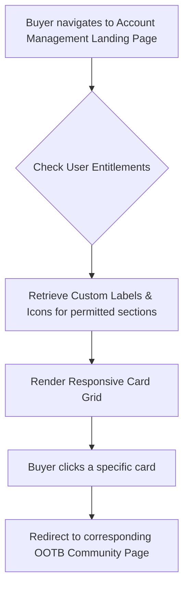

# Account Management Dashboard Redesign

**ID:** FS-001
**Version:** 1.0
**Status:** Draft
**Type:** Functional Specification

## Overview & Purpose
The current B2B commerce storefront utilizes a standard out-of-the-box (OOTB) left-sidebar navigation for account management, with content displayed in stacked containers. To align with the Amazon Business visual direction, the account management landing page must be redesigned into a centralized dashboard featuring a grid of navigational cards. By transforming the navigation into a visual card grid, the interface provides clearer, more distinct touchpoints for account management while retaining the exact underlying data model, fields, and redirection logic of the OOTB implementation.

## Goals
*   **OBJ-01:** Align the account management landing page layout with the Amazon Business card-grid design. (Measure: 100% of legacy sidebar navigation links are represented as cards on the new dashboard).
*   **OBJ-02:** Maintain existing OOTB functionality and data structures. (Measure: Zero new custom objects or fields are created to support the new layout).

## Target Users
*   **Entitled Buyer:** Authenticated users accessing their account settings who need to easily find and understand account management sections.

## Stakeholders
*   **Entitled Buyer:** 
    *   *Decision authority:* None
    *   *Concerns:* Easily finding account management sections (e.g., Order History, Profile); clear understanding of what each section contains.
*   **Storefront Administrator:**
    *   *Decision authority:* Approves final UI layout and label translations.
    *   *Concerns:* Ability to translate card titles and descriptions; no disruption to existing OOTB data models.

## Scope (In / Out)
**In Scope:**
*   Redesign of the Account Management landing page into a responsive card grid layout.
*   Mapping of 8 specific OOTB sections to cards: My Profile, Order History, My Quotes, My List, Manage Purchase Order, Addresses, My Department, and Contact Us.
*   Integration with Custom Labels for multi-language support for card titles and subtitles.
*   Integration with standard Salesforce SLDS icons or a registered shared module for card icons.
*   Enforcement of existing user entitlements for card visibility.

**Out of Scope:**
*   Redesigning the internal layouts of the destination pages (e.g., the actual Order History list view).
*   Creating new backend data models, fields, or Apex controllers for data retrieval.
*   Creating new account management features or pages not present in the current OOTB setup.

## MoSCoW
None specified.

## Functional Requirements
*   **FR-01:** The system shall display a grid of navigation cards on the account landing page, mapping to the existing OOTB sections: My Profile, Order History, My Quotes, My List, Manage Purchase Order, Addresses, My Department, and Contact Us.
*   **FR-02:** The system shall route the user to the standard OOTB community pages when a card is clicked, preserving existing redirection logic.
*   **FR-03:** The system shall source all card titles and subtitle descriptions from Custom Labels to support multi-language localization.
*   **FR-04:** The system shall render an icon for each card using standard Salesforce SLDS icons or icons from the registered shared module.
*   **FR-05:** The system shall evaluate existing user entitlements and only display cards for which the user has access permissions (derived from BR-02).

## User Stories
*   **US-01:** As an Entitled Buyer, I want to view my account options as a grid of descriptive cards, so that I can easily identify and navigate to different account management sections like Order History or Profile.

## Inputs/Outputs/Data Flow
**Inputs:**
*   User Session & Entitlements (determines which OOTB sections the user can access).
*   Custom Labels (provides localized text strings for card titles and subtitles).
*   SLDS / Shared Module Icon Library (provides visual assets for cards).

**Outputs:**
*   Rendered UI Component (Responsive Card Grid).
*   Target URLs (passed to the browser/router upon card click).

**Data Flow:**
1. Page load triggers component initialization.
2. Component requests user entitlements for the 8 defined OOTB sections.
3. Component fetches Custom Labels for permitted sections.
4. Component renders the grid, mapping icons, labels, and OOTB URLs to each permitted card.

## Flows

## Edge Cases & Error States
*   **EC-01 (Missing Custom Label):** If a custom label for a card title or description is missing or empty, the system shall gracefully render the card without the description (or use a fallback standard label) and log a warning to the console.
*   **EC-02 (Lacks Permission):** If the user lacks permission for a specific OOTB section, the system shall omit the corresponding card from the grid entirely, without leaving a blank space or broken layout.

## Acceptance Criteria

**For FR-01 & US-01 (View account dashboard layout):**
*   **Given** I am an authenticated buyer navigating to the Account Management landing page
*   **When** the page loads
*   **Then** I see a grid layout of cards representing my account options.
*   **Given** I am viewing the card grid
*   **When** I look at an individual card
*   **Then** the card displays an icon, a bold title, and a brief subtitle description.

**For FR-02 & US-01 (Navigate via account cards):**
*   **Given** I am on the Account Management dashboard
*   **When** I click on a specific card
*   **Then** I am redirected to the corresponding existing OOTB page for that section.

**For FR-03 (Custom Labels):**
*   **Given** the storefront is configured for a specific language
*   **When** the Account Management dashboard loads
*   **Then** the card titles and subtitles are displayed in the configured language sourced from Custom Labels.

**For FR-04 (Icons):**
*   **Given** the Account Management dashboard is loading
*   **When** the cards are rendered
*   **Then** each card displays its assigned standard SLDS icon or shared module icon.

**For FR-05 & EC-02 (Entitlements):**
*   **Given** I am an authenticated buyer who does *not* have permission to access "Manage Purchase Order"
*   **When** I load the Account Management dashboard
*   **Then** the "Manage Purchase Order" card is not visible in the grid.

**For EC-01 (Missing Labels):**
*   **Given** the Custom Label for a card's subtitle is deleted or empty
*   **When** the Account Management dashboard loads
*   **Then** the affected card renders normally without the subtitle, the layout does not break, and a warning is logged to the browser console.

**For NFR-01 & US-01 (Responsive grid layout):**
*   **Given** I am viewing the Account Management dashboard on a desktop viewport
*   **When** I resize the browser window to a mobile viewport (standard SLDS mobile breakpoint)
*   **Then** the card grid collapses into a single column layout.

**For NFR-02 (Accessibility):**
*   **Given** I am navigating the Account Management dashboard using a keyboard
*   **When** I press the 'Tab' key
*   **Then** focus moves sequentially through each visible card with a clear visual focus indicator
*   **And When** I press the 'Enter' key on a focused card
*   **Then** I am redirected to the corresponding OOTB page.

## Non-Functional Requirements
*   **NFR-01 (Usability/Responsiveness):** The card grid layout must be responsive, displaying multiple columns on desktop and a single column on mobile devices. (Target: Layout breaks gracefully at standard SLDS breakpoints).
*   **NFR-02 (Accessibility):** Each navigation card must be fully operable via keyboard. (Target: 100% of cards receive visible focus states and can be activated using the Enter key).
*   **NFR-03 (Maintainability):** The UI component must be a 'dumb' presentation component that receives its configuration (labels, icons, URLs) without hardcoding. (Target: 0 hardcoded URLs or English strings in the component HTML/JS).

## Assumptions
*   **AD-01:** The existing left-sidebar navigation will be hidden or removed on the new landing page to prevent redundant navigation paths. (Impact if wrong: The page will look cluttered and confusing with two competing navigation paradigms).
*   **Platform Assumption:** Based on the terminology used (OOTB community pages, Custom Labels, SLDS icons, Apex controllers), this solution is being built on the Salesforce platform (likely Salesforce B2B Commerce / Experience Cloud).

## Dependencies
*   **AD-02:** Icons for the cards will be available in the standard SLDS library or the project's shared icon module. (Impact if wrong: Development will be blocked until custom SVG assets are provided and approved).
*   **OOTB Routing:** The existing OOTB community page URLs and routing logic must remain stable and accessible to the new UI component.

## Open Questions
*   **OQ-01:** Should the legacy left sidebar be completely removed from all sub-pages (like Order History), or only replaced on the main landing page? *(Recommended default: Remove the sidebar from the main landing page to feature the card grid, but retain a simplified navigation or breadcrumb on sub-pages to allow users to return to the dashboard easily).*
*   **OQ-02:** What are the exact subtitle descriptions and standard SLDS icons to be used for each of the 8 OOTB links (My Quotes, My List, Addresses, etc.)? *(Recommended default: Use standard SLDS utility icons and draft concise English descriptions in Custom Labels for business approval during the build phase).*
*   **OQ-03:** What is the MoSCoW prioritization for the listed requirements? (None was specified in the provided documentation).

## Success Metrics
*   **SM-01 (Leading) — Navigation Parity:** 100% of OOTB sidebar links are mapped to functional cards. (Data required: Manual QA verification against the legacy sidebar).