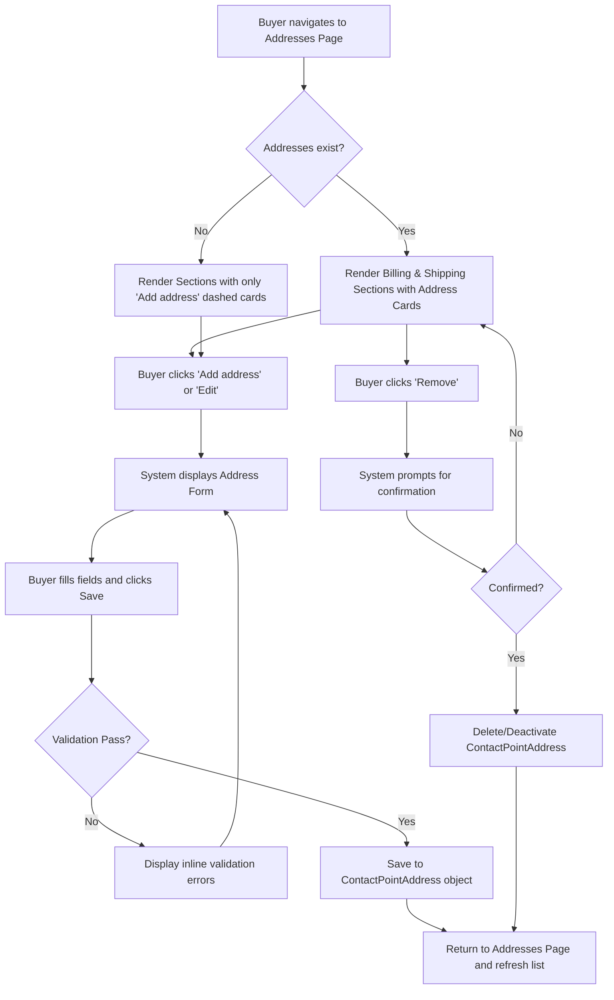

# B2B Commerce LWR Address Management Redesign
**ID:** B2B-ADDR-001
**Version:** 1.0
**Status:** Draft
**Type:** Functional Specification

## Overview & Purpose
The organization requires a visual and functional redesign of the existing Salesforce B2B Commerce LWR Address page to mirror the Amazon Business address management experience. Entitled buyers currently use this page to manage their addresses, but the interface needs to be updated to provide a more intuitive, familiar layout featuring distinct sections for Billing and Shipping addresses. This redesign must strictly utilize the existing B2B Commerce Developer Agent, standard Salesforce objects (`ContactPointAddress`), and supported APIs without introducing any custom objects or fields. The new design will adopt Amazon's signature styling—including dashed 'Add Address' cards, typography, and spacing—while preserving all existing buyer permissions and checkout functionality.

## Goals
*   **OBJ-01:** Align the address management UI with the Amazon Business visual design to improve buyer familiarity and usability. (Measure: 100% compliance with the provided design reference for layout, typography, and colors during UAT).
*   **OBJ-02:** Maintain existing architectural integrity by exclusively using standard Salesforce objects and APIs. (Measure: Zero new custom objects or custom fields created for address management).

## Target Users
*   **Entitled Buyer:** End-users who need to easily distinguish between billing and shipping addresses, quickly add/edit/remove addresses, and set default addresses for faster checkout.

## Stakeholders
*   **Entitled Buyer:** Primary user of the interface. (Decision authority: None).
*   **B2B Commerce Administrator:** Approves technical implementation and adherence to standard objects. Concerned with ensuring the storefront remains maintainable and avoiding technical debt from custom data models.

## Scope
**In Scope:**
*   Visual redesign of the Address Management page to match the provided Amazon Business references.
*   Separation of addresses into distinct "Billing Addresses" and "Shipping Addresses" sections.
*   Implementation of dashed "Add address" cards.
*   Add, Edit, and Remove functionality for addresses.
*   Setting and displaying default addresses (Billing and Shipping).
*   Mapping form inputs to standard Salesforce `ContactPointAddress` fields.

**Out of Scope:**
*   Modifications to the checkout flow or checkout UI.
*   Integration with external geolocation or address validation services (e.g., Google Maps).
*   Implementation of the 'Autofill your current location' feature.
*   Implementation of the 'Amazon collection location' feature.
*   Creation of any custom objects or custom fields.

## MoSCoW
None specified.

## Functional Requirements
*   **FR-01:** The system shall display Billing and Shipping addresses in two separate, distinct sections on the Addresses page.
*   **FR-02:** The system shall render a dashed 'Add address' card as the first item in both the Billing and Shipping address sections.
*   **FR-03:** The system shall provide an Add/Edit Address form that captures standard address fields (Country, Name, Phone, Street, City, State, Postal Code) and an Address Type selector.
*   **FR-04:** The system shall persist new and updated addresses to the standard Salesforce `ContactPointAddress` object.
*   **FR-05:** The system shall allow users to initiate editing of an existing `ContactPointAddress` record via an 'Edit' link on the address card.
*   **FR-06:** The system shall allow users to remove a `ContactPointAddress` record via a 'Remove' link on the address card, subject to confirmation.
*   **FR-07:** The system shall support setting an address as the default Billing or Shipping address via a checkbox on the address form.
*   **FR-08:** The system shall display a 'Default:' indicator in the header of the address card for the currently set default addresses.
*   **BR-01:** Addresses must be stored exclusively using the standard Salesforce `ContactPointAddress` object.
*   **BR-02:** No new custom objects or custom fields may be created to support this feature.
*   **BR-03:** Every address must have its `AddressType` field explicitly set to either 'Billing' or 'Shipping'.

## User Stories

*   **US-01:** As an Entitled Buyer, I want to view my addresses separated into Billing and Shipping sections, so that I can easily find and manage the correct address type.
    *   *Acceptance Criteria:* See AC-01, AC-02, AC-03.
*   **US-02:** As an Entitled Buyer, I want to add a new address using a form that lets me choose the address type, so that I can expand my delivery or billing options.
    *   *Acceptance Criteria:* See AC-04, AC-05, AC-06, AC-07.
*   **US-03:** As an Entitled Buyer, I want to edit or remove an existing address from its card, so that my address book remains up to date.
    *   *Acceptance Criteria:* See AC-08, AC-09, AC-10.
*   **US-04:** As an Entitled Buyer, I want to set an address as default, so that my preferred addresses are automatically selected during checkout.
    *   *Acceptance Criteria:* See AC-11, AC-12.

## Inputs/Outputs/Data Flow
**Inputs:**
*   User data entered into the Add/Edit Address form:
    *   Country/Region (Dropdown)
    *   Full name (Text)
    *   Mobile number (Text)
    *   Pincode / Postal Code (Text)
    *   Flat, House no., Building, Company, Apartment (Text - mapped to Street)
    *   Area, Street, Sector, Village (Text - mapped to Street)
    *   Town/City (Text)
    *   State (Dropdown)
    *   Address Type (Billing / Shipping)
    *   Make this my default address (Boolean/Checkbox)

**Outputs:**
*   Creation or modification of a `ContactPointAddress` record in the Salesforce database.
*   UI updates reflecting the saved address as a card in the respective Billing or Shipping section.

**Data Flow:**
1. Buyer requests Address Management page -> System queries `ContactPointAddress` records for the current user -> System renders UI.
2. Buyer submits Add/Edit form -> LWC captures input -> Standard B2B Commerce API / Connect API validates payload -> Salesforce Database commits `ContactPointAddress` -> System returns success response -> UI refreshes.

## Flows

## Edge Cases & Error States
*   **EC-01 (No existing addresses):** If the buyer has no existing addresses, the page displays the 'Billing Addresses' and 'Shipping Addresses' sections, each containing only the dashed 'Add address' card.
*   **EC-02 (Long address strings):** If an address contains long strings or names, the address card layout must tolerate approximately 30% text expansion, wrapping text appropriately without breaking the card boundaries or overlapping elements.
*   **EC-03 (Removal of address in active cart):** If a buyer attempts to remove an address currently in use by an active cart, the system relies on standard B2B Commerce logic to either prevent the deletion with an inline error message or handle it gracefully without breaking the checkout session.
*   **Error State (Validation Failure):** If the buyer leaves mandatory fields blank and submits the form, the system displays inline validation errors and the address is not saved.

## Acceptance Criteria (Given/When/Then)

**View Addresses (US-01)**
*   **AC-01:** GIVEN the buyer navigates to the Addresses page WHEN the page loads THEN the page displays two distinct sections: 'Billing Addresses' and 'Shipping Addresses'.
*   **AC-02:** GIVEN the buyer is viewing the address sections WHEN the sections render THEN each section displays a dashed 'Add address' card with a plus icon as the first item, matching image 1.
*   **AC-03:** GIVEN the buyer has existing addresses WHEN the addresses are displayed THEN they appear as cards with the buyer's details, matching the typography, spacing, and borders shown in image 1.

**Add Address (US-02)**
*   **AC-04:** GIVEN the buyer is on the Addresses page WHEN the buyer clicks the dashed 'Add address' card in either section THEN the system navigates to the 'Add a new address' form matching the layout in image 2.
*   **AC-05:** GIVEN the buyer is on the Add Address form WHEN the form is displayed THEN it includes a selection for Address Type (Billing or Shipping), defaulting to the section from which the 'Add address' card was clicked.
*   **AC-06:** GIVEN the buyer has filled out all mandatory fields in the Add Address form WHEN the buyer clicks the 'Add address' button THEN the system saves the address as a `ContactPointAddress` record and returns the buyer to the Addresses page.
*   **AC-07:** GIVEN the buyer leaves mandatory fields blank WHEN the buyer clicks the 'Add address' button THEN the system displays inline validation errors and the address is not saved.

**Edit/Remove Address (US-03)**
*   **AC-08:** GIVEN the buyer is viewing their address cards WHEN the buyer clicks the 'Edit' link on an address card THEN the system opens the address form pre-populated with the current details.
*   **AC-09:** GIVEN the buyer has modified the address details in the form WHEN the buyer clicks the save button THEN the system updates the existing `ContactPointAddress` record.
*   **AC-10:** GIVEN the buyer is viewing their address cards WHEN the buyer clicks the 'Remove' link on an address card THEN the system prompts for confirmation before deleting or deactivating the address.

**Default Address (US-04)**
*   **AC-11:** GIVEN the buyer is on the Add Address form WHEN the buyer checks 'Make this my default address' and saves THEN the new address is marked as the default for its respective type (Billing or Shipping).
*   **AC-12:** GIVEN the buyer has a default address set WHEN the address cards are displayed THEN the corresponding address card displays a 'Default:' indicator at the top, matching the design in image 1.

## Non-Functional Requirements
*   **NFR-01 (Usability):** The UI shall closely replicate the Amazon Business address page design, specifically the colors, typography, dashed cards, spacing, borders, and responsive layout shown in the provided images. (Target: 100% alignment with visual reference during design review).
*   **NFR-02 (Accessibility):** The page shall implement semantic landmarks, keyboard operability, visible focus states, alt text, and aria-live regions on dynamic content. (Target: Zero WCAG 2.1 AA violations in automated and manual accessibility testing).
*   **NFR-03 (Maintainability):** The implementation shall use standard LWC practices and standard commerce wire adapters/Connect API over custom Apex where possible. (Target: Zero custom Apex classes created if standard APIs support the required `ContactPointAddress` operations).
*   **NFR-04 (Security):** Any required Apex controllers must enforce FLS/CRUD, use `with sharing`, and be bulk-safe. (Target: 100% pass rate on Salesforce security scanner).

## Assumptions
*   **AD-01:** Standard B2B Commerce APIs support the required CRUD operations for `ContactPointAddress` without needing custom Apex. (Impact if wrong: Development effort will increase to build custom, secure Apex controllers).
*   **AD-02:** The 'Default' address logic can be managed using the standard `IsDefault` flag on `ContactPointAddress`. (Impact if wrong: Custom logic or configuration would be needed, potentially conflicting with the no-custom-fields rule).

## Dependencies
*   Standard Salesforce B2B Commerce APIs and standard `ContactPointAddress` object availability.

## Open Questions
*   **OQ-01:** Image 2 shows fields for 'Landmark' and 'Delivery instructions' which do not map cleanly to standard `ContactPointAddress` fields. How should these be handled given the rule against creating custom fields? *(Recommended default: Omit these fields from the form to strictly adhere to the no-custom-fields constraint).*
*   **OQ-02:** Image 1 shows an Amazon logo next to the 'Default:' indicator. Should we use the specific storefront's logo, or text only? *(Recommended default: Use text only ('Default:') to avoid hardcoding brand assets).*
*   **OQ-03:** Image 1 includes an 'Edit delivery preferences' link. Does this map to an existing standard feature in the current org? *(Recommended default: Omit this link, as delivery preferences typically require custom data models which are out of scope).*
*   **OQ-04:** No MoSCoW prioritization was provided in the requirements document. Should all listed features be considered "Must Have" for the initial release?

## Success Metrics
*   **SM-01 (Leading):** Address creation success rate. Target: 99% of submitted Add Address forms successfully create a `ContactPointAddress` record. (Data required: System logs of form submissions vs. successful database commits).
*   **SM-02 (Lagging):** Checkout completion rate. Target: Maintained or improved compared to the period before the redesign. (Data required: Analytics on cart-to-order conversion rates).