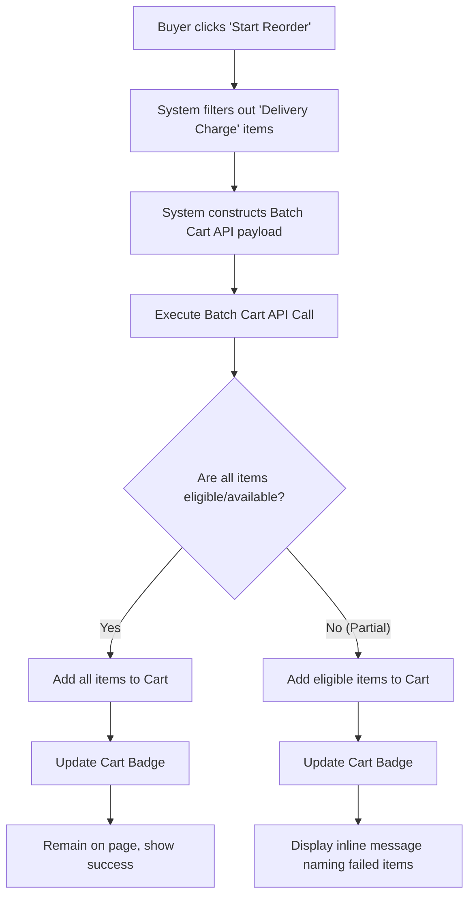

# B2B Order History Component
**ID:** SPEC-B2B-ORDER-HISTORY
**Version:** 1.0
**Status:** Draft
**Type:** Functional Specification

## Overview & Purpose
B2B buyers require a streamlined, secure way to view past purchases, track order statuses, and quickly reorder items. The out-of-the-box Salesforce B2B Commerce order list displays all orders for an entire account, which violates the strict business requirement that users must only see orders they personally placed. This specification defines a custom Order History component for the list view that visually mirrors the Amazon Business experience. It provides advanced filtering, sorting, and a one-click reorder capability while strictly enforcing user-level data isolation.

## Goals
*   **OBJ-01:** Ensure buyers can only view and interact with orders they personally placed. (Measure: Zero incidents of cross-user order visibility within the custom list component).
*   **OBJ-02:** Accelerate the repeat purchasing process for buyers. (Measure: 15% of all orders are initiated via the 'Start Reorder' action within 3 months of launch).

## Target Users
*   **B2B Buyer:** End users who need to find specific past orders quickly and reorder previously purchased items without navigating the catalog.
*   **Store Administrator:** System users who configure the page size and layout of the component within Salesforce Experience Builder.

## Stakeholders
*   **B2B Buyer:** (Decision authority: None)
*   **Store Administrator:** (Decision authority: Defines default Builder properties)

## Scope
**In Scope:**
*   Custom Lightning Web Component (LWC) for Order History list view.
*   Strict user-level data isolation overriding standard account sharing.
*   Advanced filtering (Order Date, Order Status) and sorting capabilities.
*   Partial, case-insensitive search by Order Number, PO Number, or product.
*   One-click "Start Reorder" functionality via batch cart API.
*   Dynamic status styling and mobile-responsive vertical stacking.
*   Experience Builder configuration properties (page size).

**Out of Scope:**
*   Modifications to the standard Order Detail page.
*   Account-wide order visibility toggles.
*   Returns, cancellations, and invoice generation.
*   CSV export functionality.
*   Approval workflow execution from the list view.
*   Reordering 'Delivery Charge' items.
*   Viewing orders placed by other users on the same account.

## MoSCoW
None specified.

## Functional Requirements

*   **FR-01: User-Level Data Isolation**
    *   The system shall display a list of OrderSummary records where the `OrderSummary.OriginalOrder.OwnerId` exactly matches the logged-in user's ID.
    *   *Acceptance Criteria:* GIVEN I am an authenticated buyer WHEN the order list loads THEN the system only returns and displays OrderSummary records where the OwnerId matches my user ID.
*   **FR-02: Exclude Delivery Charges**
    *   The system shall exclude OrderItemSummary records with Type 'Delivery Charge' from the item count, product thumbnails, and reorder payload.
    *   *Acceptance Criteria:* GIVEN an order contains a 'Delivery Charge' WHEN the order card is rendered or reordered THEN the delivery charge is not counted in the "ITEMS" total, does not display a thumbnail, and is not added to the cart during reorder.
*   **FR-03: Order Date Filtering**
    *   The system shall provide an Order Date filter with specific time-bound options.
    *   *Acceptance Criteria:* GIVEN I interact with the Order Date filter WHEN I open the dropdown THEN I see the options: 'Past 30 days', 'Past 3 months' (default), 'Past 6 months', 'Past year', and 'All time'.
*   **FR-04: Dynamic Status Filtering**
    *   The system shall provide an Order Status filter dynamically populated based on the user's actual order history.
    *   *Acceptance Criteria:* GIVEN I interact with the Order Status filter WHEN I open the dropdown THEN I see 'All statuses' (default) followed only by statuses that exist on my historical orders (e.g., Created, Pending for Approval, Shipped).
*   **FR-05: Sorting Options**
    *   The system shall provide a Sort by dropdown to order the list.
    *   *Acceptance Criteria:* GIVEN I interact with the Sort by dropdown WHEN I open it THEN I see the options: 'Newest first' (default), 'Oldest first', 'Total high-low', and 'Total low-high'.
*   **FR-06: Order Search**
    *   The system shall execute a partial, case-insensitive search against Order Number, PO Number, and product fields.
    *   *Acceptance Criteria:* GIVEN I enter a query in the search bar WHEN I submit the search THEN the list updates to show only my orders matching the query across Order Number, PO Number, or product fields, ignoring case.
*   **FR-07: Experience Builder Configuration**
    *   The system shall expose the page size as an Experience Builder property.
    *   *Acceptance Criteria:* GIVEN I am a Store Administrator WHEN I configure the component in Experience Builder THEN I can set a default page size (defaulting to 10) up to a maximum of 50.
*   **FR-08: Dynamic Status Styling**
    *   The system shall apply dynamic color styling to the order status text based on the status value.
    *   *Acceptance Criteria:* GIVEN an order card is displayed WHEN the status is rendered THEN pending statuses are orange/red, shipped/delivered are green, rejected/cancelled are red, and all others are neutral text colors.
*   **FR-09: Mobile Responsiveness**
    *   The system shall stack the order card layout vertically on mobile devices.
    *   *Acceptance Criteria:* GIVEN I view the component on a mobile viewport WHEN the page renders THEN the order cards stack vertically and horizontal scrolling is prevented.
*   **FR-10: Batch Reorder Execution**
    *   The system shall execute the reorder action via a single batch cart API call.
    *   *Acceptance Criteria:* GIVEN I click 'Start Reorder' WHEN the system processes the request THEN it packages all eligible items into a single batch cart API payload rather than making individual calls per item.
*   **BR-01: Override Standard Sharing**
    *   Order visibility is strictly limited to the placing user, overriding standard account-wide sharing for this component.
    *   *Acceptance Criteria:* GIVEN standard Salesforce sharing allows account-wide order visibility WHEN the custom component queries orders THEN it programmatically restricts the results to the placing user only.
*   **BR-02: Currency Formatting**
    *   Currency formatting must be determined by the WebStore at runtime or the order's specific currency, using `lightning-formatted-number`.
    *   *Acceptance Criteria:* GIVEN an order total is displayed WHEN the component renders THEN the currency symbol and format match the WebStore or order currency without hardcoded symbols.

## User Stories

*   **US-01 — As a B2B Buyer, I want to view and filter my order history, so that I can track my past purchases and their current fulfillment status**
    *   *Scenario: View default order list*
        *   GIVEN I am an authenticated buyer with past orders
        *   WHEN I navigate to the Order History page
        *   THEN I see a paginated list of only my orders, sorted by newest first, with a default date filter of 'Past 3 months'
    *   *Scenario: Filter orders by status*
        *   GIVEN I am viewing my order history
        *   WHEN I select 'Pending for Approval' from the Order Status filter
        *   THEN the list updates to show only my orders with that status and resets to page 1
    *   *Scenario: Clear all filters*
        *   GIVEN I have applied custom filters and sorting
        *   WHEN I click the 'Clear all filters' link
        *   THEN the filters reset to 'Past 3 months', 'All statuses', and 'Newest first', and the list resets to page 1
    *   *Scenario: Empty state*
        *   GIVEN I have no orders matching the selected filters
        *   WHEN the list loads
        *   THEN I see the message 'We couldn't find any orders from that period of time. Try changing your filter settings.' and a 'Continue Shopping' button
*   **US-02 — As a B2B Buyer, I want to search my orders, so that I can find a specific order without manually paging through the list**
    *   *Scenario: Search by partial order number*
        *   GIVEN I am viewing my order history
        *   WHEN I enter a partial order number and press Enter or click 'Search Orders'
        *   THEN the list displays my orders that contain the search string, ignoring case
    *   *Scenario: Search for another user's order*
        *   GIVEN I am viewing my order history
        *   WHEN I search for an order number placed by a different user on my account
        *   THEN the search returns no results
*   **US-03 — As a B2B Buyer, I want to reorder a past purchase, so that I can quickly buy the same items again**
    *   *Scenario: Successfully reorder all items*
        *   GIVEN I am viewing an order card in my history
        *   WHEN I click 'Start Reorder'
        *   THEN all eligible items are added to my cart, the cart badge updates, and I remain on the page
    *   *Scenario: Partially successful reorder*
        *   GIVEN I click 'Start Reorder' on an order where some items are no longer available
        *   WHEN the batch cart API call completes
        *   THEN the available items are added to my cart, and I see an inline message naming the items that failed to add
*   **US-04 — As a B2B Buyer, I want to view order details, so that I can see the full breakdown of a specific order**
    *   *Scenario: Navigate to order details*
        *   GIVEN I am viewing an order card in my history
        *   WHEN I click 'View Details'
        *   THEN I am navigated to the standard Order Detail page for that order

## Inputs/Outputs/Data Flow
*   **Inputs:**
    *   Logged-in User ID (`OwnerId`).
    *   Filter selections (Date range, Status).
    *   Sort selection.
    *   Search string (Order Number, PO Number, Product).
    *   Reorder action trigger (Order ID).
*   **Outputs:**
    *   Paginated list of `OrderSummary` records (filtered and sorted).
    *   Product thumbnails (via Commerce Product API).
    *   Cart updates (Items added, Cart badge count updated).
    *   UI Messages (Empty state, Partial success warning, Error state).

## Flows

## Edge Cases & Error States
*   **EC-01: Partial Reorder Entitlement Failure**
    *   *Condition:* A user attempts to reorder an order containing products they are no longer entitled to purchase.
    *   *Expected Behavior:* The system adds the eligible items to the cart and displays an inline message naming the items that failed to add. This is treated as a normal partial success, not a system exception.
*   **EC-02: Query Permission Failure**
    *   *Condition:* The system encounters a permission failure when attempting to query orders.
    *   *Expected Behavior:* The system displays an explicit error state, never an empty state, to prevent users from falsely believing they have no orders.
*   **EC-03: URL Manipulation for Cross-User Access**
    *   *Condition:* A user manually alters the URL to navigate to the standard Order Detail page of an order placed by another user on their account.
    *   *Expected Behavior:* The standard Salesforce sharing rules apply. If sharing is not restricted per user, the user will see the order (this is a known risk documented in Open Questions).

## Acceptance Criteria
*(Acceptance criteria for all features are explicitly defined within the Functional Requirements and User Stories sections above, utilizing the GIVEN/WHEN/THEN format).*

## Non-Functional Requirements
*   **NFR-01 (Security):** Apex queries must run in `USER_MODE` by default, and any system fallback must hard-filter to the running user's ID. Target: 100% of queries enforce user-level isolation.
*   **NFR-02 (Performance):** The order history list must load and render within 2 seconds for a user with 500 historical orders. Target: < 2000ms load time.
*   **NFR-03 (Accessibility):** The component must meet WCAG 2.1 AA standards, including semantic landmarks, keyboard operability, and aria-live regions for dynamic updates. Target: 0 WCAG 2.1 AA violations.
*   **NFR-04 (Maintainability):** Apex controllers must have test coverage of at least 85%, specifically including a test proving User A cannot list, search, count, or reorder User B's orders. Target: >= 85% code coverage.

## Assumptions
*   **AD-02:** The standard Order Detail page will be used as-is, accepting the risk that users might access other users' orders via direct URL manipulation if standard sharing is not locked down. (Impact if wrong: Additional custom development would be required to build a secure custom Order Detail page).

## Dependencies
*   **AD-01:** Product images for the order thumbnails must be retrieved via the Commerce product API. (Impact if wrong: Thumbnails will fail to load as buyers do not have SOQL access to the Product2 object).

## Open Questions
*   **OQ-01:** The standard detail page likely allows same-account users to open each other's orders by URL. Should we restrict OrderSummary sharing per user to enforce strict data isolation? *(Recommended default: Yes, restrict OrderSummary sharing per user at the org level to ensure strict data isolation matches the list view behavior).*
*   **OQ-02:** The project context forbids creating Apex test classes, but the specific requirement explicitly demands >= 85% Apex coverage and a specific isolation test. Which rule takes precedence? *(Recommended default: Follow the specific requirement to create the Apex test class for B2BOrderHistoryController, overriding the general project context rule for this specific feature).*

## Success Metrics
*   **SM-01 (Leading):** Component Load Time. Target: < 2 seconds for 95th percentile of users. (Data required: Client-side performance monitoring metrics).
*   **SM-02 (Lagging):** Reorder Feature Adoption. Target: 15% of all orders are placed via the 'Start Reorder' button. (Data required: Cart and order origin analytics).