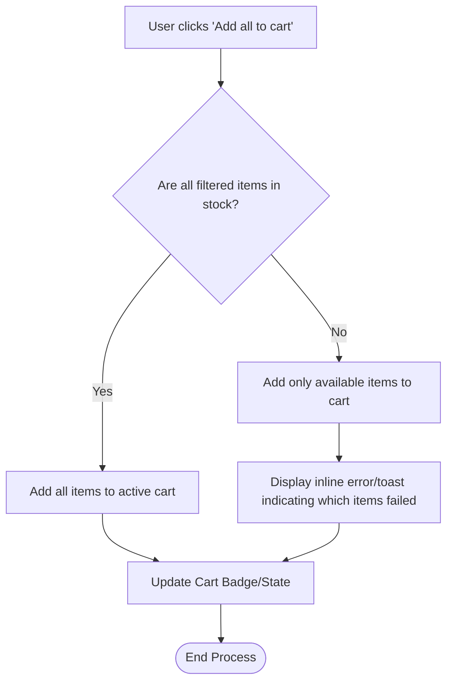
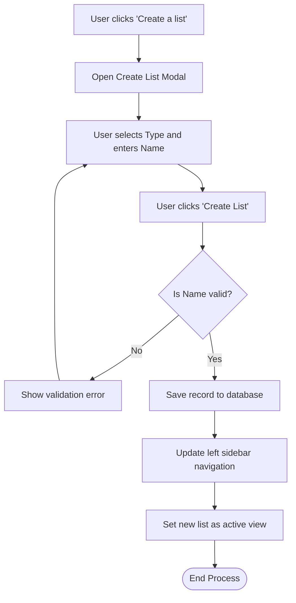

# B2B Storefront Shopping Lists Feature
**ID:** SPEC-001
**Version:** 1.0
**Status:** Draft
**Type:** Functional Specification

## Overview & Purpose
Entitled buyers in the B2B storefront need the ability to save and organize products for future purchases. The current experience lacks a structured way to maintain distinct lists for one-off purchases versus recurring orders, which slows down the procurement process for frequent buyers. 

To mirror the Amazon Business experience, the storefront will introduce a 'Shopping List' feature supporting two distinct list types: 'Reorder Lists' (where items remain after purchase) and 'Shopping Lists' (where items are filtered out after purchase). This specification outlines the functional requirements for the list creation, management, filtering, sorting, and cart-addition capabilities, while explicitly excluding sharing and inline editing for this initial phase.

## Goals
- **OBJ-01:** Reduce the time it takes for entitled buyers to execute recurring orders.
  - *Measure:* Average time from login to checkout for users utilizing Reorder Lists decreases by 20%.
- **OBJ-02:** Increase the average items per cart.
  - *Measure:* 15% increase in cart size when items are added via the Shopping List 'Add all to cart' function.

## Target Users
- **Entitled Buyer:** End-users who need to easily find previously saved items and distinguish between one-time purchases and recurring procurement lists.

## Stakeholders
- **Entitled Buyer:** (No decision authority) Concerned with usability and organization of saved items.
- **Storefront Administrator:** (Decision authority for data model extensions/object creation) Concerned with data model cleanliness (standard vs custom objects) and performance of list rendering with large catalogs.

## Scope
**In Scope:**
- Verification/provisioning of the underlying data object (Standard Wishlist or Custom Shopping_List__c).
- Left-hand navigation sidebar for list categorization ('Your reorder lists', 'Your shopping lists').
- Main product list view with filtering (All, Out-of-stock, Purchased, Unpurchased) and sorting.
- Right-hand summary panel calculating Item quantity, List price, Savings, and Estimated subtotal.
- Modals for creating and managing lists (Name, Type, Description, Shipping Address, 'Do not spoil my surprises' flag).
- Adding individual items or all available filtered items to the active cart.

**Out of Scope:**
- Sharing shopping lists with other users.
- Shared with group or public list functionality.
- Downloading the shopping list.
- Selecting specific buying options or variants directly from the list view (Select options to purchase).
- Inline editing of items in the list (e.g., bulk editing comments, quantities, or priorities).

## MoSCoW
None specified.

## Functional Requirements
- **FR-01:** The system shall verify the existence of a suitable standard object (e.g., Wishlist) or custom object (e.g., Shopping_List__c) and its required fields prior to component deployment, provisioning it if missing.
- **FR-02:** The system shall display a left-hand navigation sidebar categorizing lists into 'Your reorder lists' and 'Your shopping lists'.
- **FR-03:** The system shall calculate and display a List Summary containing Item quantity, List price, Savings, and Estimated subtotal based on the items currently visible in the list. Out-of-stock items must be excluded from the subtotal.
- **FR-04:** The system shall provide a modal to create a new list, requiring a Name and a Type selection (Reorder List or Shopping List).
- **FR-05:** The system shall provide a Manage List modal accessible via a Settings icon, allowing updates to Name, Description, Shipping Address, List Type, and a 'Do not spoil my surprises' flag.
- **FR-06:** The system shall provide a filter dropdown with the exact options: All, Out-of-stock, Purchased, Unpurchased.
- **FR-07:** The system shall provide a sort dropdown allowing users to order list items (e.g., Price high to low).
- **FR-08:** The system shall allow users to add all currently filtered, available items to their cart via an 'Add all to cart' button.
- **FR-09 (Business Rule):** Items in a 'Reorder List' shall remain visible on the list after being purchased. Items in a 'Shopping List' shall be automatically filtered from the default view after purchase.
- **FR-10 (Business Rule):** All monetary values must display in the user's active currency based on Salesforce multi-currency settings, overriding any static currency symbols.

## User Stories

**US-01 — As an Entitled Buyer, I want to view my shopping lists and their contents, so that I can review the products I have saved for future purchase.**
- **Scenario: Navigate to the Shopping Lists page**
  - GIVEN I am an authenticated entitled buyer 
  - WHEN I navigate to the Lists section of the storefront 
  - THEN I see a left sidebar displaying 'Your reorder lists' and 'Your shopping lists'
- **Scenario: Select a list**
  - GIVEN I am viewing the Lists section 
  - WHEN I select a specific list from the left sidebar 
  - THEN the main content area displays the list title, product count, and the items within that list
- **Scenario: View list summary calculations**
  - GIVEN I am viewing a populated list 
  - WHEN the page renders 
  - THEN the right sidebar displays a 'List Summary' including Item quantity, List price, Savings, and Estimated subtotal formatted in the active currency

**US-02 — As an Entitled Buyer, I want to create a new list, so that I can organize my saved items based on my purchasing intent.**
- **Scenario: Open the Create List modal**
  - GIVEN I am on the Shopping Lists page 
  - WHEN I click the 'Create a list' button in the left sidebar 
  - THEN a modal opens prompting me to choose a list type and enter a list name
- **Scenario: Create a Reorder List**
  - GIVEN I have the Create List modal open 
  - WHEN I select 'Reorder List', enter a valid name, and click 'Create List' 
  - THEN the list is created, appears under 'Your reorder lists' in the sidebar, and is set as the active view
- **Scenario: Create a Shopping List**
  - GIVEN I have the Create List modal open 
  - WHEN I select 'Shopping List', enter a valid name, and click 'Create List' 
  - THEN the list is created, appears under 'Your shopping lists' in the sidebar, and is set as the active view

**US-03 — As an Entitled Buyer, I want to manage the settings of an existing list, so that I can update its details or change its type.**
- **Scenario: Open the Manage List modal**
  - GIVEN I am viewing a specific list 
  - WHEN I click the 'Settings' icon next to the list title 
  - THEN a 'Manage list' modal opens displaying the current List name, Description, Shipping Address, List type, and a 'Do not spoil my surprises' checkbox
- **Scenario: Save list setting changes**
  - GIVEN I have the Manage list modal open 
  - WHEN I modify the fields and click 'Save Changes' 
  - THEN the modal closes and the list reflects the updated settings

**US-04 — As an Entitled Buyer, I want to filter and sort items within my list, so that I can easily find specific products in large lists.**
- **Scenario: Filter list items by status**
  - GIVEN I am viewing a list with multiple items 
  - WHEN I select a status from the filter dropdown (All, Out-of-stock, Purchased, Unpurchased) 
  - THEN the main content area updates to display only items matching the selected status
- **Scenario: Sort list items**
  - GIVEN I am viewing a list with multiple items 
  - WHEN I select an option from the 'Sort by' dropdown (e.g., Price high to low) 
  - THEN the items in the main content area are reordered accordingly
- **Scenario: Search within list (Proposed)**
  - GIVEN I am viewing a list with multiple items 
  - WHEN I enter text into the 'Search items in this list' input 
  - THEN the list filters in real-time to show only items whose titles match the search text

**US-05 — As an Entitled Buyer, I want to add list items to my cart, so that I can proceed to checkout with my saved items.**
- **Scenario: Add all items to cart**
  - GIVEN I am viewing a list with available items 
  - WHEN I click the 'Add all to cart' button in the List Summary panel 
  - THEN all available items in the current filtered view are added to my active cart
- **Scenario: Add individual item to cart**
  - GIVEN I am viewing a list with available items 
  - WHEN I click the 'Add to Cart' button on a specific product card 
  - THEN that specific item is added to my active cart

## Inputs/Outputs/Data Flow
**Inputs:**
- **Create List Modal:** List Type (Radio: Reorder/Shopping), List Name (Text).
- **Manage List Modal:** List Name (Text), Description (Text area), Shipping Address (Dropdown), List Type (Radio), 'Do not spoil my surprises' (Checkbox).
- **List View Controls:** Search query (Text), Sort option (Dropdown), Filter status (Dropdown).

**Outputs:**
- **List Summary Panel:** Item quantity (Integer), List price (Currency), Savings (Currency), Estimated subtotal (Currency).
- **Cart:** New cart item records generated upon clicking 'Add to Cart' or 'Add all to cart'.

**Data Flow:**
1. User requests list data -> LWC queries Salesforce backend (Wishlist or Shopping_List__c).
2. Backend returns list metadata and associated product items.
3. LWC calculates List Summary totals client-side based on the currently filtered/visible dataset.
4. User initiates 'Add to cart' -> LWC sends payload of selected product IDs and quantities to Salesforce B2B Commerce Cart API.
5. Cart API responds with success/failure -> LWC updates UI (toast messages, cart badge).

## Flows

## Edge Cases & Error States
- **EC-01: Partial Out-of-Stock on Bulk Add**
  - *Given* a user clicks 'Add all to cart' on a list containing both available and out-of-stock items, *When* the system processes the request, *Then* only available items are added to the cart, and an inline AuraHandledException or toast message is displayed indicating which items could not be added.
- **EC-02: Empty List State**
  - *Given* a user navigates to a list with no items, *When* the page renders, *Then* the main content area displays a localized empty state message (e.g., 'This list is empty') and the List Summary panel displays zeros for all calculations.
- **EC-03: Deleted Catalog Product**
  - *Given* a product previously added to a list is deleted from the master catalog, *When* the user views the list, *Then* the item is displayed in a disabled state with a 'Currently unavailable' message (or hidden entirely), and its price is excluded from all summary calculations.

## Acceptance Criteria
*(Acceptance criteria are documented inline within the User Stories and Edge Cases sections above.)*

## Non-Functional Requirements
- **NFR-01 (Accessibility):** Dynamic updates to the list content (filtering, sorting, searching) must be announced to screen readers. All dynamic list regions must use `aria-live='polite'`.
- **NFR-02 (Performance):** The list view must render promptly even for lists with many items. List switching and rendering must complete in under 1.5 seconds for lists containing up to 100 items.
- **NFR-03 (Compliance):** Currency formatting must strictly follow the US multi-currency configuration of the org. 100% of monetary values must use `lightning-formatted-number` bound to the active currency, with no hardcoded symbols.

## Assumptions
- **AD-02:** The 'Priority' field shown on product cards (e.g., 'Priority: Medium') is a read-only display in this phase, as inline editing is out of scope.
- **Platform Assumption:** The solution is being built using Salesforce Lightning Web Components (LWC) for a B2B Commerce storefront, based on references to `AuraHandledException`, `lightning-formatted-number`, and standard Salesforce objects.

## Dependencies
- **AD-01:** The underlying data model (either standard Salesforce Wishlist or a custom object) must be verified or deployed prior to LWC development. Failure to do so will block LWC components from retrieving or saving list data.

## Open Questions
- **OQ-01:** Should the system use the standard Salesforce B2B Commerce Wishlist object, or create a custom `Shopping_List__c` object to handle the 'Reorder' vs 'Shopping' list types? *(Recommended default: Extend the standard Wishlist object with a custom 'List_Type__c' picklist field).*
- **OQ-02:** Image 1 and 3 show an 'Edit items in list' link and 'Edit comment, quantity & priority' links, but the requirements state inline editing is out of scope. Should these links be hidden entirely in the UI for this phase? *(Recommended default: Hide them entirely).*
- **OQ-03:** What behavior is expected when the user checks 'Do not spoil my surprises' in the Manage List modal? *(Recommended default: Store the boolean value on the list record, but implement no functional UI changes in this phase since sharing is out of scope).*
- **OQ-04:** What is the MoSCoW prioritization for the listed functional requirements?
- **OQ-05:** The UI mockups show "Shared with you", "Shared with your groups", and "Public Lists" in the left navigation. Since sharing is out of scope, should these navigation sections be hidden entirely, or displayed in a disabled/empty state?

## Success Metrics
- **SM-01 (Leading):** List Creation Rate. Target: 20% of active entitled buyers create at least one list within the first 30 days of launch. (Data required: Count of unique users creating records in the List object).
- **SM-02 (Lagging):** List-to-Cart Conversion. Target: 15% of all cart additions originate from the Shopping List page. (Data required: Analytics tracking on the 'Add to Cart' and 'Add all to cart' buttons within the list component).