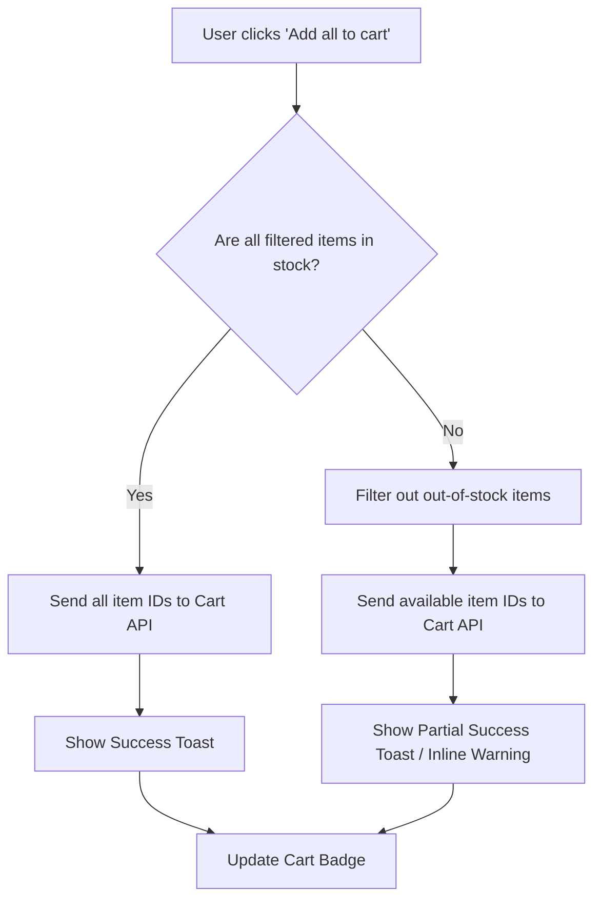

# Shopping List

**Title:** B2B Storefront Shopping Lists
**ID:** B2B-SHOP-LIST-001
**Version:** 1.0
**Status:** Draft
**Type:** Functional Specification

# Overview & Purpose

Entitled buyers in the B2B storefront require the ability to save and organize products for future purchases. The current experience lacks a structured way to maintain distinct lists for one-off purchases versus recurring orders, slowing down the procurement process for frequent buyers. 

To mirror the Amazon Business experience, the storefront will introduce a 'Shopping List' feature supporting two distinct list types: 'Reorder Lists' (where items remain after purchase) and 'Shopping Lists' (where items are filtered out after purchase). This specification details the front-end components and underlying logic required to support list creation, management, filtering, and cart integration within the Salesforce B2B Commerce environment.

# Goals

- **OBJ-01:** Reduce the time it takes for entitled buyers to execute recurring orders. (Measure: Average time from login to checkout for users utilizing Reorder Lists decreases by 20%).
- **OBJ-02:** Increase the average items per cart. (Measure: 15% increase in cart size when items are added via the Shopping List 'Add all to cart' function).

# Target Users

- **Entitled Buyer:** End-users navigating the B2B storefront who need to easily find previously saved items and distinguish between one-time purchases and recurring procurement lists.

# Stakeholders

- **Storefront Administrator:** Approves data model extensions and object creation; concerned with data model cleanliness (standard vs. custom objects) and performance of list rendering with large catalogs.

# Scope

**In Scope:**
- Verification/provisioning of the underlying Salesforce object (Standard Wishlist or Custom Shopping_List__c).
- Left-hand navigation sidebar for list categorization.
- Main product list view with filtering (All, Out-of-stock, Purchased, Unpurchased), sorting, and searching.
- Right-hand List Summary panel with dynamic calculations.
- Modals for creating and managing lists.
- Adding individual items or all available filtered items to the active cart.

**Out of Scope:**
- Sharing shopping lists with other users.
- Shared with group or public list functionality.
- Downloading the shopping list.
- Selecting specific buying options or variants directly from the list view (Select options to purchase).
- Inline editing of items in the list (e.g., bulk editing comments, quantities, or priorities).

# MoSCoW

None specified.

# Functional Requirements

- **FR-01:** The system shall verify the existence of a suitable standard object (e.g., Wishlist) or custom object (e.g., Shopping_List__c) and its required fields prior to component deployment, provisioning it if missing.
- **FR-02:** The system shall display a left-hand navigation sidebar categorizing lists into 'Your reorder lists' and 'Your shopping lists'.
- **FR-03:** The system shall calculate and display a List Summary containing Item quantity, List price, Savings, and Estimated subtotal based on the items currently visible in the list.
- **FR-04:** The system shall provide a modal to create a new list, requiring a Name and a Type selection (Reorder List or Shopping List).
- **FR-05:** The system shall provide a Manage List modal accessible via a Settings icon, allowing updates to Name, Description, Shipping Address, List Type, and a 'Do not spoil my surprises' flag.
- **FR-06:** The system shall provide a filter dropdown with the exact options: All, Out-of-stock, Purchased, Unpurchased.
- **FR-07:** The system shall provide a sort dropdown allowing users to order list items (e.g., Price high to low).
- **FR-08:** The system shall allow users to add all currently filtered, available items to their cart via an 'Add all to cart' button.

# User Stories

- **US-01:** As an Entitled Buyer, I want to view my shopping lists and their contents, so that I can review the products I have saved for future purchase.
- **US-02:** As an Entitled Buyer, I want to create a new list, so that I can organize my saved items based on my purchasing intent.
- **US-03:** As an Entitled Buyer, I want to manage the settings of an existing list, so that I can update its details or change its type.
- **US-04:** As an Entitled Buyer, I want to filter and sort items within my list, so that I can easily find specific products in large lists.
- **US-05:** As an Entitled Buyer, I want to add list items to my cart, so that I can proceed to checkout with my saved items.

# Inputs/Outputs/Data Flow

- **Inputs:**
  - User interactions (clicks on navigation, modal inputs for list creation/management, filter/sort selections, 'Add to cart' actions).
  - Salesforce multi-currency configuration (determines currency formatting).
  - Product catalog data (availability, pricing, status).
- **Outputs:**
  - Rendered DOM elements (Sidebar, Main List View, Summary Panel, Modals).
  - DML operations to Salesforce (Create/Update List records, Insert Cart Item records).
  - Dynamic ARIA announcements for screen readers upon list updates.
- **Data Flow:**
  1. LWC requests list data from Salesforce Apex controller upon initialization.
  2. Apex queries the List object (Wishlist or Custom) and associated List Items, returning them to the LWC.
  3. LWC processes the data, applying client-side filtering/sorting based on user input, and recalculates the List Summary totals.
  4. Upon 'Add all to cart', LWC sends a payload of available item IDs to Apex.
  5. Apex inserts items into the active Cart object and returns a success/partial-success response.
  6. LWC updates the UI (toast messages, inline errors) based on the Apex response.

# Flows

# Edge Cases & Error States

- **EC-01:** User selects 'Add all to cart' but some items are out of stock.
  - *Handling:* The system adds only the available items to the cart and displays an inline AuraHandledException or toast message indicating which items could not be added (e.g., "1 item is out-of-stock. This item can't be added to cart, but you can choose an alternate.").
- **EC-02:** User views a list that has no items.
  - *Handling:* The main content area displays a localized empty state message (e.g., 'This list is empty') and the List Summary shows zeros.
- **EC-03:** A product previously added to a list is deleted from the catalog.
  - *Handling:* The item is either hidden from the list or displayed in a disabled state with a 'Currently unavailable' message, and is excluded from summary calculations.

# Acceptance Criteria

**US-01: View Shopping Lists**
- **Given** I am an authenticated entitled buyer **When** I navigate to the Lists section of the storefront **Then** I see a left sidebar displaying 'Your reorder lists' and 'Your shopping lists'.
- **Given** I am viewing the Lists section **When** I select a specific list from the left sidebar **Then** the main content area displays the list title, product count, and the items within that list.
- **Given** I am viewing a populated list **When** the page renders **Then** the right sidebar displays a 'List Summary' including Item quantity, List price, Savings, and Estimated subtotal formatted in the active currency.

**US-02: Create a New List**
- **Given** I am on the Shopping Lists page **When** I click the 'Create a list' button in the left sidebar **Then** a modal opens prompting me to choose a list type (Reorder List or Shopping List) and enter a list name.
- **Given** I have the Create List modal open **When** I select 'Reorder List', enter a valid name, and click 'Create List' **Then** the list is created, appears under 'Your reorder lists' in the sidebar, and is set as the active view.
- **Given** I have the Create List modal open **When** I select 'Shopping List', enter a valid name, and click 'Create List' **Then** the list is created, appears under 'Your shopping lists' in the sidebar, and is set as the active view.

**US-03: Manage List Settings**
- **Given** I am viewing a specific list **When** I click the 'Settings' icon next to the list title **Then** a 'Manage list' modal opens displaying the current List name, Description, Shipping Address, List type, and a 'Do not spoil my surprises' checkbox.
- **Given** I have the Manage list modal open **When** I modify the fields and click 'Save Changes' **Then** the modal closes and the list reflects the updated settings.

**US-04: Filter and Sort Items**
- **Given** I am viewing a list with multiple items **When** I select a status from the filter dropdown (All, Out-of-stock, Purchased, Unpurchased) **Then** the main content area updates to display only items matching the selected status.
- **Given** I am viewing a list with multiple items **When** I select an option from the 'Sort by' dropdown **Then** the items in the main content area are reordered accordingly.
- **Given** I am viewing a list with multiple items **When** I enter text into the 'Search items in this list' input **Then** the list filters in real-time to show only items whose titles match the search text.

**US-05: Add Items to Cart**
- **Given** I am viewing a list with available items **When** I click the 'Add all to cart' button in the List Summary panel **Then** all available items in the current filtered view are added to my active cart.
- **Given** I am viewing a list with available items **When** I click the 'Add to Cart' button on a specific product card **Then** that specific item is added to my active cart.

# Non-Functional Requirements

- **NFR-01 (Accessibility):** Dynamic updates to the list content (filtering, sorting, searching) must be announced to screen readers. Target: All dynamic list regions use `aria-live='polite'`.
- **NFR-02 (Performance):** The list view must render promptly even for lists with many items. Target: List switching and rendering completes in under 1.5 seconds for lists containing up to 100 items.
- **NFR-03 (Compliance):** Currency formatting must strictly follow the US multi-currency configuration of the org. Target: 100% of monetary values use `lightning-formatted-number` bound to the active currency, with no hardcoded symbols.

# Assumptions

- **AD-02:** The 'Priority' field shown on product cards (e.g., 'Priority: Medium') is a read-only display in this phase, as inline editing is out of scope.
- **Business Rule Assumption (BR-01):** The filtering of items from a 'Shopping List' after purchase occurs automatically via backend logic upon successful checkout, not immediately upon adding to the cart.
- **Business Rule Assumption (BR-03):** List Summary totals (List price, Savings, Estimated subtotal) only calculate based on the items currently visible in the filtered view, explicitly excluding out-of-stock items from the subtotal.

# Dependencies

- **AD-01:** The underlying data model (either standard Salesforce Wishlist or a custom object) must be verified or deployed prior to LWC development.

# Open Questions

- **OQ-01:** Should the system use the standard Salesforce B2B Commerce Wishlist object, or create a custom `Shopping_List__c` object to handle the 'Reorder' vs 'Shopping' list types? (Recommended default: Extend the standard Wishlist object with a custom `List_Type__c` picklist field).
- **OQ-02:** The provided UI designs show an 'Edit items in list' link and 'Edit comment, quantity & priority' links, but the requirements state inline editing is out of scope. Should these links be hidden entirely? (Recommended default: Hide these links entirely for this phase).
- **OQ-03:** What behavior is expected when the user checks 'Do not spoil my surprises' in the Manage List modal? (Recommended default: Store the boolean value on the list record, but implement no functional UI changes in this phase since sharing is out of scope).
- **OQ-04:** What is the MoSCoW prioritization for the requirements listed in this document?

# Success Metrics

- **SM-01 (Leading):** List Creation Rate. Target: 20% of active entitled buyers create at least one list within the first 30 days of launch. (Data required: Count of unique users creating records in the List object).
- **SM-02 (Lagging):** List-to-Cart Conversion. Target: 15% of all cart additions originate from the Shopping List page. (Data required: Analytics tracking on the 'Add to Cart' and 'Add all to cart' buttons within the list component).