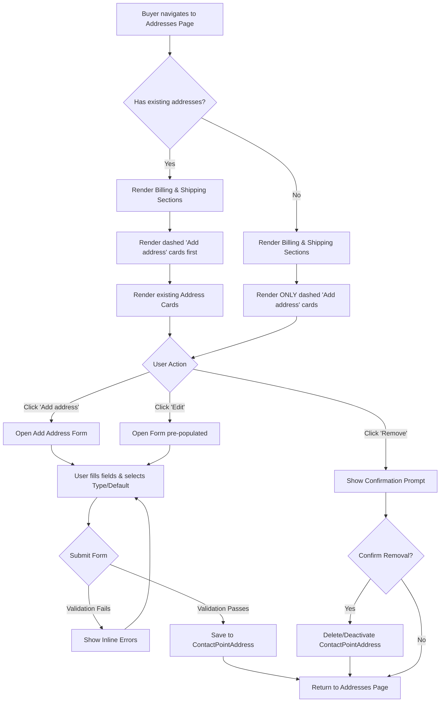

# Title & metadata
* **ID:** SPEC-B2B-ADDR-001
* **Version:** 1.0
* **Status:** Draft
* **Type:** Functional Specification
* **Title:** Salesforce B2B Commerce Address Management Redesign

# Overview & Purpose
The organization requires a visual and functional redesign of the existing Salesforce B2B Commerce LWR Address page to mirror the Amazon Business address management experience. Entitled buyers currently use this page to manage their addresses, but the interface needs to be updated to provide a more intuitive, familiar layout featuring distinct sections for Billing and Shipping addresses. This redesign must strictly utilize the existing B2B Commerce Developer Agent, standard Salesforce objects (`ContactPointAddress`), and supported APIs without introducing any custom objects or fields. The new design will adopt Amazon's signature styling—including dashed 'Add Address' cards, typography, and spacing—while preserving all existing buyer permissions and checkout functionality.

# Goals
* **OBJ-01:** Align the address management UI with the Amazon Business visual design to improve buyer familiarity and usability. (Measure: 100% compliance with the provided design reference for layout, typography, and colors during UAT).
* **OBJ-02:** Maintain existing architectural integrity by exclusively using standard Salesforce objects and APIs. (Measure: Zero new custom objects or custom fields created for address management).

# Target Users
* **Entitled Buyer:** End-users who need to easily distinguish between billing and shipping addresses, quickly add/edit/remove addresses, and set default addresses for faster checkout.

# Stakeholders
* **Entitled Buyer:**
  * *Decision authority:* None
  * *Concerns:* Easily distinguishing between billing and shipping addresses; quickly adding, editing, or removing addresses; setting default addresses for faster checkout.
* **B2B Commerce Administrator:**
  * *Decision authority:* Approves technical implementation and adherence to standard objects.
  * *Concerns:* Ensuring the storefront remains maintainable; avoiding technical debt from custom data models.

# Scope (In / Out)
**In Scope:**
* Splitting the address dashboard into distinct 'Billing Addresses' and 'Shipping Addresses' sections.
* Implementation of dashed 'Add address' cards in both sections.
* Add/Edit Address form capturing standard fields (Country, Name, Phone, Street, City, State, Postal Code) and Address Type.
* Setting default Billing/Shipping addresses.
* Editing and removing existing addresses.
* UI styling matching the provided Amazon reference images (typography, spacing, borders, responsive layout).

**Out of Scope:**
* Modifications to the checkout flow or checkout UI.
* Integration with external geolocation or address validation services (e.g., Google Maps).
* Implementation of the 'Autofill your current location' feature.
* Implementation of the 'Amazon collection location' feature.
* Custom fields for 'Landmark' or 'Delivery instructions'.
* 'Edit delivery preferences' functionality.

# MoSCoW
None specified. 

# Functional Requirements
* **FR-01:** The system shall display Billing and Shipping addresses in two separate, distinct sections on the Addresses page.
* **FR-02:** The system shall render a dashed 'Add address' card as the first item in both the Billing and Shipping address sections.
* **FR-03:** The system shall provide an Add/Edit Address form that captures standard address fields (Country, Name, Phone, Street, City, State, Postal Code) and an Address Type selector.
* **FR-04:** The system shall persist new and updated addresses to the standard Salesforce `ContactPointAddress` object.
* **FR-05:** The system shall allow users to initiate editing of an existing `ContactPointAddress` record via an 'Edit' link on the address card.
* **FR-06:** The system shall allow users to remove a `ContactPointAddress` record via a 'Remove' link on the address card, subject to confirmation.
* **FR-07:** The system shall support setting an address as the default Billing or Shipping address via a checkbox on the address form.
* **FR-08:** The system shall display a 'Default:' indicator in the header of the address card for the currently set default addresses.

# User Stories

* **US-01:** As an Entitled Buyer, I want to view my addresses separated into Billing and Shipping sections, so that I can easily find and manage the correct address type.
  * **Scenario: View address dashboard**
    * GIVEN the buyer navigates to the Addresses page
    * WHEN the page loads
    * THEN the page displays two distinct sections: 'Billing Addresses' and 'Shipping Addresses'
  * **Scenario: View 'Add address' cards**
    * GIVEN the buyer is viewing the address sections
    * WHEN the sections render
    * THEN each section displays a dashed 'Add address' card with a plus icon as the first item, matching the design reference
  * **Scenario: View existing addresses**
    * GIVEN the buyer has existing addresses
    * WHEN the addresses are displayed
    * THEN they appear as cards with the buyer's details, matching the typography, spacing, and borders of the design reference

* **US-02:** As an Entitled Buyer, I want to add a new address using a form that lets me choose the address type, so that I can expand my delivery or billing options.
  * **Scenario: Open the Add Address form**
    * GIVEN the buyer is on the Addresses page
    * WHEN the buyer clicks the dashed 'Add address' card in either section
    * THEN the system navigates to the 'Add a new address' form
  * **Scenario: Select address type**
    * GIVEN the buyer is on the Add Address form
    * WHEN the form is displayed
    * THEN it includes a selection for Address Type (Billing or Shipping), defaulting to the section from which the 'Add address' card was clicked
  * **Scenario: Submit a new address successfully**
    * GIVEN the buyer has filled out all mandatory fields in the Add Address form
    * WHEN the buyer clicks the 'Add address' button
    * THEN the system saves the address as a `ContactPointAddress` record and returns the buyer to the Addresses page
  * **Scenario: Validation errors on Add Address form**
    * GIVEN the buyer leaves mandatory fields blank
    * WHEN the buyer clicks the 'Add address' button
    * THEN the system displays inline validation errors and the address is not saved

* **US-03:** As an Entitled Buyer, I want to edit or remove an existing address from its card, so that my address book remains up to date.
  * **Scenario: Edit an existing address**
    * GIVEN the buyer is viewing their address cards
    * WHEN the buyer clicks the 'Edit' link on an address card
    * THEN the system opens the address form pre-populated with the current details
  * **Scenario: Save edited address**
    * GIVEN the buyer has modified the address details in the form
    * WHEN the buyer clicks the save button
    * THEN the system updates the existing `ContactPointAddress` record
  * **Scenario: Remove an existing address**
    * GIVEN the buyer is viewing their address cards
    * WHEN the buyer clicks the 'Remove' link on an address card
    * THEN the system prompts for confirmation before deleting or deactivating the address

* **US-04:** As an Entitled Buyer, I want to set an address as default, so that my preferred addresses are automatically selected during checkout.
  * **Scenario: Set default during creation**
    * GIVEN the buyer is on the Add Address form
    * WHEN the buyer checks 'Make this my default address' and saves
    * THEN the new address is marked as the default for its respective type (Billing or Shipping)
  * **Scenario: View default indicator**
    * GIVEN the buyer has a default address set
    * WHEN the address cards are displayed
    * THEN the corresponding address card displays a 'Default:' indicator at the top

# Inputs/Outputs/Data Flow
* **Inputs:**
  * User data entry: Country, Full Name, Mobile Number, Postal Code, Street (Flat/House no., Area/Street), City, State.
  * User selections: Address Type (Billing/Shipping), Is Default (Boolean).
  * User actions: Click 'Add address', 'Edit', 'Remove', 'Save'.
* **Outputs:**
  * UI rendering of Address Cards categorized by type.
  * Inline validation error messages.
  * Confirmation modals for deletion.
* **Data Flow:**
  1. User interacts with the LWC frontend.
  2. LWC captures input and validates required fields locally.
  3. Validated payload is sent via standard B2B Commerce wire adapters or Connect API.
  4. Salesforce backend processes the request, enforcing FLS/CRUD and 'with sharing' rules.
  5. Data is committed to the standard `ContactPointAddress` object.
  6. Success/Failure response is returned to the LWC to update the UI state.

# Flows

# Edge Cases & Error States
* **EC-01: Buyer has no existing addresses.**
  * *State:* The page displays the 'Billing Addresses' and 'Shipping Addresses' sections, each containing only the dashed 'Add address' card.
* **EC-02: Long address strings or names.**
  * *State:* The address card layout tolerates approximately 30% text expansion, wrapping text appropriately without breaking the card boundaries or overlapping elements.
* **EC-03: Removal of an address currently in use by an active cart.**
  * *State:* The system relies on standard B2B Commerce logic to either prevent the deletion with an inline error message or handle it gracefully without breaking the checkout session.
* **EC-04: Form submission failure (Network or API error).**
  * *State:* The system displays a generic error toast/message ("An error occurred while saving the address. Please try again.") and retains the user's input in the form.
* **EC-05: Mandatory fields left blank.**
  * *State:* The system prevents submission and highlights the missing fields with inline red error text.

# Acceptance Criteria (Given/When/Then)
* **For FR-01 (Sections):** GIVEN the user is on the Addresses page, WHEN the page renders, THEN there must be two distinct UI sections labeled "Billing Addresses" and "Shipping Addresses".
* **For FR-02 (Add Card):** GIVEN the user is viewing either section, WHEN the list of addresses renders, THEN the first item in the grid must be a dashed card containing a plus icon and the text "Add address".
* **For FR-03 (Form Fields):** GIVEN the user is on the Add/Edit form, WHEN they view the inputs, THEN they must see fields for Country, Name, Phone, Street, City, State, Postal Code, and a selector for Address Type.
* **For FR-04 (Persistence):** GIVEN the user submits a valid form, WHEN the system processes the request, THEN a standard `ContactPointAddress` record is created or updated in the database.
* **For FR-05 (Edit):** GIVEN the user clicks "Edit" on an address card, WHEN the form opens, THEN all fields must be pre-populated with the data from that specific `ContactPointAddress` record.
* **For FR-06 (Remove):** GIVEN the user clicks "Remove", WHEN they confirm the prompt, THEN the `ContactPointAddress` record is deleted or deactivated, and the card is removed from the UI.
* **For FR-07 (Set Default):** GIVEN the user checks "Make this my default address" and saves, WHEN the record is saved, THEN the `IsDefault` flag on the `ContactPointAddress` is set to true for that address type.
* **For FR-08 (Default Indicator):** GIVEN an address has `IsDefault` set to true, WHEN the card renders, THEN a header containing the text "Default:" is displayed at the top of the card.

# Non-Functional Requirements
* **NFR-01 (Usability):** The UI shall closely replicate the Amazon Business address page design, specifically the colors, typography, dashed cards, spacing, borders, and responsive layout shown in the provided images. Target: 100% alignment with visual reference during design review.
* **NFR-02 (Accessibility):** The page shall implement semantic landmarks, keyboard operability, visible focus states, alt text, and aria-live regions on dynamic content. Target: Zero WCAG 2.1 AA violations in automated and manual accessibility testing.
* **NFR-03 (Maintainability):** The implementation shall use standard LWC practices and standard commerce wire adapters/Connect API over custom Apex where possible. Target: Zero custom Apex classes created if standard APIs support the required `ContactPointAddress` operations.
* **NFR-04 (Security):** Any required Apex controllers must enforce FLS/CRUD, use 'with sharing', and be bulk-safe. Target: 100% pass rate on Salesforce security scanner.

# Assumptions
* **AD-01:** Standard B2B Commerce APIs support the required CRUD operations for `ContactPointAddress` without needing custom Apex. (Impact if wrong: Development effort will increase to build custom, secure Apex controllers).
* **AD-02:** The 'Default' address logic can be managed using the standard `IsDefault` flag on `ContactPointAddress`. (Impact if wrong: Custom logic or configuration would be needed, potentially conflicting with the no-custom-fields rule).
* **AD-03:** To comply with the strict "no custom fields" rule, fields shown in the reference images for 'Landmark' and 'Delivery instructions', as well as the 'Edit delivery preferences' link, are omitted from the final implementation.
* **AD-04:** The 'Default:' indicator on the address card will use text only, omitting the Amazon logo shown in the reference image to avoid hardcoding brand assets and maintain reusability.
* **AD-05:** The reference URL (`https://www.amazon.in/a/addresses?ref_=ya_d_c_addr`) requires authentication and is inaccessible to automated tools; therefore, all visual and functional requirements are strictly derived from the provided screenshots and business intent.

# Dependencies
* Salesforce B2B Commerce LWR framework.
* Standard Salesforce `ContactPointAddress` object metadata and permissions.
* B2B Commerce Developer Agent for implementation.

# Open Questions
* **OQ-01:** What is the specific MoSCoW prioritization for the requirements listed in this document?
* **OQ-02:** What is the exact expected system behavior (e.g., soft delete vs. hard delete, specific error message text) when a user attempts to remove an address that is currently tied to an active cart?

# Success Metrics
* **SM-01 (Leading):** Address creation success rate. Target: 99% of submitted Add Address forms successfully create a `ContactPointAddress` record. (Data required: System logs of form submissions vs. successful database commits).
* **SM-02 (Lagging):** Checkout completion rate. Target: Maintained or improved compared to the period before the redesign. (Data required: Analytics on cart-to-order conversion rates).